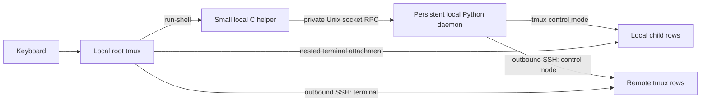

# Design and alternatives

The UI requirement decides the architecture: visible nested rows and keyboard
navigation, with the controller authoritative about the
tree. Every branch is a dedicated tmux server, with a single `tree` session and
one window per child. Branch windows run terminal clients attached to child
servers. A leaf window runs the user's command.

The root owns navigation keys. Local RPC selects a row or tab through its tmux
control connection and updates row colors. A remote row never asks a local row
to run anything. The terminal's ordinary input/output is separate from the
control stream. Each branch has its own socket namespace, isolated from the
user's existing tmux sessions and configuration.

There is one long-running Python daemon per named workspace. It owns the live
tree and keeps one `tmux -C` process connected to each row, using persistent SSH
channels within one shared SSH connection per host alias. A navigation binding starts `nested-tmux-key`, a
small C executable that sends an action such as `right` to the daemon's Unix
socket, waits for acknowledgement, and exits. The daemon translates it into tmux
commands such as `next-window -t tree` and writes them to the existing control
process's stdin; framed replies arrive on stdout. Ordinary typing and terminal
rendering go through tmux directly. Native bindings such as detach also stay in
tmux. The remote host needs tmux and SSH, with no Python daemon installed there.

Nix builds the helper with the C compiler and links only libc. Bindings record
its absolute path. It starts a process for each shortcut, with no Python
interpreter/import cost. Interactive creation/rename prompts and the general
CLI remain in Python. Source and pip installations fall back to the Python
helper if `nested-tmux-key` is absent from PATH when the controller prepares its
bindings. The controller and its tmux/SSH connections are reused. Remote round
trips and serialized controller work still add latency, especially for operations
that query several rows. See the [navigation measurements](performance.md).

## Why these interfaces

The application exposes a small JSON protocol on a mode-0600 Unix socket inside
a mode-0700 directory. Key bindings invoke a local helper that writes to this
socket. Operations are serialized, so concurrent shortcuts do not interleave
tmux commands or update the tree concurrently.

The native helper accepts only the fixed keyboard actions. It sends one JSON
request with `op: key` and receives a compact ASCII `OK` or `ERR` line; the
general CLI still receives JSON. Replies are bounded at 4 KiB, diagnostics are
sanitized, and a monotonic 30-second deadline covers connection, writes, and
reads. Partial I/O is handled explicitly. A missing acknowledgement leaves the
action's outcome unknown; the helper never retries a mutation. This path uses
the same private local socket and adds no remote control endpoint.

For tmux itself, use its documented [control mode](https://github.com/tmux/tmux/wiki/Control-Mode)
through a persistent `tmux -C` subprocess. This gives commands and framed replies
over stdin/stdout, and works unchanged over `ssh -T`. The tmux client handles
the actual server socket. Writing directly to tmux's internal binary
[client/server protocol](https://github.com/tmux/tmux/blob/3.4/proc.c) would couple
the application to internal structures and descriptor passing without improving
the UI or trust boundary.

Commands are encoded as tmux arguments; SSH commands are separately shell
quoted. Launches use `respawn-pane` with a launch command and cwd, never text
typed into a running shell. No synthetic Alt+F12 or parent-socket environment
variable is used. A timeout closes that control stream and does not retry a
mutation whose outcome is unknown.

## SSH connection ownership and recovery

The controller owns one private OpenSSH master per workspace, host alias, and
SSH configuration path. Every remote control client, terminal attachment, and
cleanup command connects to that master's Unix socket. The master uses
`ControlMaster=yes` and `ControlPersist=300`; channel clients use
`ControlMaster=no`. The socket is mode 0600 inside the workspace's mode-0700
directory, independent of any `ControlPath` in the user's SSH configuration.
Only local configuration chooses its path and host.

Only the controller starts masters. A file lock serializes startup, and a dead
socket is removed only after a failed liveness check and a refused Unix socket
connection. Channel clients specify `ProxyCommand=false` so failure to use the
master cannot fall back to an independent TCP connection. The master itself
honors trusted `ProxyJump`/`ProxyCommand` settings. Agent/X11/port forwarding and
local command hooks are disabled when creating the master, as well as on clients.
OpenSSH's documented [ControlMaster](https://man.openbsd.org/ssh_config#ControlMaster)
and [ControlPersist](https://man.openbsd.org/ssh_config#ControlPersist) implement
sharing and five-minute idle expiry; the controller need not remain alive for
the master to survive.

The half-second maintenance loop schedules disconnected remote control streams
for background recovery, with up to four workers and exponential backoff from
one to 30 seconds. A worker connects a new candidate control client using
`attach-session`, never `new-session`. The main thread installs a successful
candidate only if its row and original control object are still current.
Concurrent removal, explicit reconciliation, or replacement cannot install a
stale candidate. Failed commands are never retried. Automatic recovery cannot
recreate missing servers or replay startup commands; explicit `up` can reconcile
a remote host after reboot.

The terminal bridge retries its attachment every second through the same master.
A dead master drops all its channels; once a controller worker creates its
replacement, control and display channels reattach independently. Keepalives
and bounded command deadlines detect broken connections, so recovery is not
instantaneous. Pipe readers can stop even if a multiplexed channel retains a
file descriptor after its local SSH client exits. Closing a control client first
requests detachment and then terminates it if it does not exit promptly.

When a bridge command changes on an application upgrade, its stored hash causes
only that attachment pane to respawn. Child servers and leaf processes survive.
OpenSSH's [MaxSessions](https://man.openbsd.org/sshd_config#MaxSessions) defaults
to 10: each remote row and each local-to-remote display consumes a channel, and
cleanup/recovery needs spare channels. Larger trees require raising that server
limit; the application will not evade it with additional connections.

## Live tree versus initialization

YAML is a bootstrap recipe. The local root's `@nt-tree` option stores the live
tree; per-window options store stable node paths and startup markers. The root
metadata is base64-encoded JSON, validated with the same schema as YAML.
Remote metadata is never used as local tree authority.

`up` reconnects to a live root, recovers its tree, and reconnects surviving child
servers. It only launches missing terminals or recreates missing servers.
Launch markers distinguish an unstarted window from a launched window and an
interrupted, uncertain launch. The controller checks pane exit state through
control mode on a half-second maintenance interval, removes exited leaves from
the live tree, and prunes empty ancestor rows. Closing the last terminal ends
the workspace. Internally `remain-on-exit` retains panes until this cleanup,
including commands that finish before startup completes; they are never replayed
merely because they exited. When the controller is stopped, cleanup waits for
its return. Unavailable control streams are not evidence that a terminal exited.

`--name` selects an independent workspace without a YAML file, or overrides the
name in a startup recipe. Each name maps to its own private runtime directory,
controller, and tmux socket namespace, including separate servers on remote
hosts. Dumps include the selected name. Reusing a name reconnects to that live
tree; distinct names do not share terminal state.

Adding/removing nodes changes live metadata. Dumping exports that tree with
best-effort cwd observations. It preserves the configured command, rather than
guessing how to reconstruct an arbitrary running process. No restore plugin or
shell-history scraping is involved. Node IDs remain stable when titles change.
Leaves without an explicit title enable tmux's native `automatic-rename`, with
its default format and process detection on the host running that leaf. Branch
names and explicitly assigned titles stay fixed. Export records explicit titles
even when they equal the node ID, and omits automatic program names so they
remain automatic after restoration. Maintenance re-arms native naming so quiet
commands also update after replacing their launcher shell; no process naming
algorithm is implemented in Python.

This is not a transactional distributed system: an SSH failure midway through
an edit can leave part of the requested tree created. The recorded intent lets
`up` reconnect/reconcile; an uncertain launch requires explicit inspection.
Removal and `down` terminate processes and may report an unreachable remote
host. They should not be interpreted as successful remote cleanup on failure.

## Alternatives considered

| Approach | Assessment for this project |
| --- | --- |
| Shell scripts and tmux configuration | Compact, but synthetic navigation keys and child-to-parent control make SSH and security harder to reason about. |
| [tmuxp](https://github.com/tmux-python/tmuxp) or [tmuxinator](https://github.com/tmuxinator/tmuxinator) | Useful declarative workspace launchers. We would still need to implement the nested-row interaction, runtime tree authority, and SSH trust boundary. |
| One tmux server with a synthesized multirow status bar | Reduces local process count, but requires a separate UI for ancestor selection and remote process persistence. It would no longer display the actual nested sessions. |
| [Zellij layouts](https://zellij.dev/documentation/layouts.html) | A different multiplexer/layout model; reproducing these rows and cross-host navigation adds substantial integration work. |
| [WezTerm multiplexing](https://wezterm.org/multiplexing.html) | Offers local/remote multiplexing but ties this workflow to a particular terminal frontend and its UI model. |
| A custom terminal emulator/multiplexer | Maximum UI control, with a much larger terminal compatibility and security burden. |

These are design judgments for this UI, not claims that the alternatives cannot
be extended. The chosen approach retains tmux's terminal rendering and process
lifetime management, at the cost of one server per row, nested terminal
attachments, and one SSH control channel per remote row. Initial limits are
32 levels, 1024 nodes, 60 KB of encoded live metadata, and 4 KB per RPC request.
